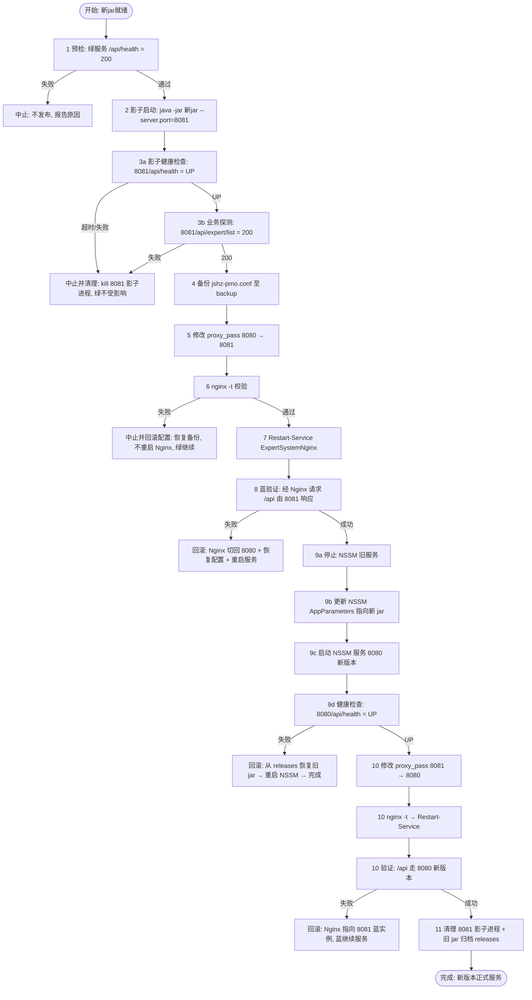

---
AIGC:
    Label: "1"
    ContentProducer: 001191440300708461136T1XGW3
    ProduceID: d9cc1e9f35e2e4edfa52a2013dbcd9a5_fdc540f5cf7411f1814c525400cd780f
    ReservedCode1: ZEQwkrtyBCzy7yBcRzJMPickSEXSWo/55XcWD0Ci9cxrAeSkSz0VENNIcBM1bdHOvFJZG1NJai/BV6IfY/N4vs1s11HldNjNtlATX4Uvy61cGiZffBmw0DKiIS9wBOZODmOebL7F6wp55H6qP3rsXoHnEHQFkNZhrPmfxSCHNoFActWEcm4iR612Klw=
    ContentPropagator: 001191440300708461136T1XGW3
    PropagateID: d9cc1e9f35e2e4edfa52a2013dbcd9a5_fdc540f5cf7411f1814c525400cd780f
    ReservedCode2: ZEQwkrtyBCzy7yBcRzJMPickSEXSWo/55XcWD0Ci9cxrAeSkSz0VENNIcBM1bdHOvFJZG1NJai/BV6IfY/N4vs1s11HldNjNtlATX4Uvy61cGiZffBmw0DKiIS9wBOZODmOebL7F6wp55H6qP3rsXoHnEHQFkNZhrPmfxSCHNoFActWEcm4iR612Klw=
---

# jshz-PMO 发布运维体系与侧边栏菜单偏移修复 设计文档

- 日期：2026-10-24
- 项目：jshz-PMO 专家库系统（Java17 + Spring Boot3 + Vue3 + Element Plus + MySQL8 + Nginx + NSSM）
- 范围：① 侧边栏一级菜单展开箭头与点击热区错位修复；② 发布运维体系 R-1~R-5 设计与落地
- 状态：设计定稿，待分批实现

---

## 1. 背景与目标

### 1.1 任务一：UI 偏移修复
用户反馈：侧边栏一级菜单（专家库/知识星球/管理员设置/个人中心）展开二级菜单时，点击视觉箭头（红圈标注）无法唤出二级菜单，必须点击箭头右侧的热区（蓝圈标注）才能展开，属明显错位偏移。

目标：**视觉箭头位置 = 可点击展开热区**，点击箭头或热区均可展开/收起，点击菜单文字仍跳父路由，无回归。

### 1.2 任务二：发布运维体系 R-1~R-5
现状核查结论：R-2（前端发布/回滚脚本）、R-3（幂等迁移脚本）已有雏形；R-1（后端蓝绿）、R-4（统一编排）、R-5（版本保留目录与后端回滚预案）缺失。

| 需求 | 名称 | 交付物 |
|---|---|---|
| R-1 | 后端蓝绿不停机发布 | `scripts/deploy-backend.ps1` + Nginx 模板蓝绿注释 |
| R-2 | 前端原子发布与回滚 | 改造 `deploy-frontend.ps1` / `rollback-frontend.ps1` |
| R-3 | 数据库向后兼容迁移规范 | 迁移脚本范式 + `docs/deployment.md` 章节 |
| R-4 | 一键发布脚本化 | `scripts/deploy-all.ps1` 统一编排 |
| R-5 | 版本保留与回滚预案 | `backend/releases/`、`frontend/releases/` + 回滚手册 |

核心指标：**15 分钟内完成回滚**；发布过程旧版本不中断服务。

---

## 2. 现状基线（已核查事实，作为设计依据）

### 2.1 前端侧边栏（UI 偏移相关）
- `frontend/src/components/SideMenuItem.vue`：
  - 模板（3-14 行）：`el-sub-menu` 的 `#title` 内自定义 `div.side-submenu-title`，含 `span.side-submenu-label`（`@click.stop` 跳父路由）与 `el-icon.side-submenu-arrow`（`<ArrowDown/>`，`@click.stop` toggleExpand）。
  - 样式：`.side-submenu-title`（53-58 行）`display:flex; align-items:center; justify-content:space-between; width:100%; padding-right:6px;`；`.side-submenu-label`（60-66 行）`flex:1; overflow:hidden; ellipsis;`；`.side-submenu-arrow`（68-74 行）仅 `transition; color; cursor:pointer; flex-shrink:0`，**无固定 width/height/margin**；展开时 `rotate(180deg)`（76-78 行）。
- `frontend/src/App.vue`：`el-aside` 固定 220px（第 10 行）；`el-menu` 未设 padding，`el-sub-menu__title` 高度 48px（108-111 行）；顶栏 `.user-area`（164-168 行）flex gap 12px，含通知铃铛（NotificationBell）、用户名、退出按钮，无独立时间元素。
- 依赖 Element Plus 默认行为：`el-sub-menu__title` 整体点击即展开/收起（EP 内置 toggle），其内容区自带左右 padding。

### 2.2 后端与进程
- `<LOCAL_PATH>`：`cd /d <LOCAL_PATH>` → `set MYSQL_PASSWORD=<真实密码，不入库>` → `java -jar target\expert-system-1.001.jar`（端口 8080 由 application.yml 决定）。
- NSSM 服务 `ExpertSystemBackend`：Application=`jdk-17.0.20.101\bin\java.exe`，AppDirectory=`<LOCAL_PATH>`，AppParameters=`-jar <LOCAL_PATH>`，AppEnvironmentExtra=`MYSQL_PASSWORD=<真实密码，不入库>`；StartType=Automatic，Running。

### 2.3 Nginx
- `<LOCAL_PATH>`，80 端口运行（NSSM 服务 `ExpertSystemNginx`）。
- `<LOCAL_PATH>`（133 行，`scripts/nginx-jshz-pmo.conf` 为同内容模板）：
  - `listen 80; server_name _;`
  - 静态根 `root <LOCAL_PATH>`，`/` 走 SPA 回退，`/assets/` expires 30d。
  - `location /api/ { proxy_pass http://127.0.0.1:8080; ... }`；`location = /api/health { proxy_pass http://127.0.0.1:8080/health; }`。
- **关键约束**：本项目 Nginx 为 NSSM 服务（LocalSystem 账户），`nginx -s reload` 会 Access denied，切流一律用 `Restart-Service ExpertSystemNginx`。

### 2.4 脚本与版本目录现状
- `scripts/`：`deploy-frontend.ps1`（79 行：备份 dist → build → 校验 index.html → `nginx -s reload`）、`rollback-frontend.ps1`（75 行：找最新 `dist_backup_*` → 当前 dist 存档 dist_broken → 恢复 → reload）、`nginx-jshz-pmo.conf`、`migrate_sqlite_to_mysql.py`。
- 现有脚本的 `nginx -s reload` 均需替换为服务重启（NSSM 约束）。
- `database/migration/`：4 个 `yyyyMMdd_add_xxx_tables.sql`，均 `CREATE TABLE IF NOT EXISTS` 幂等。
- `backend/releases/`、`frontend/releases/`、根目录 `releases/` **均不存在**；`backup/` 仅有 `sys_user_backup_20261021.csv/.xlsx`。
- `docs/deployment.md`：无发布/回滚章节。

---

## 3. 任务一：侧边栏菜单箭头偏移修复设计

### 3.1 根因分析（截图 + 代码双重确认）
1. **现象（用户截图红/蓝标注）**：视觉箭头（红色）紧贴菜单文字右侧；实际有效展开热区（蓝色）位于箭头右侧、更靠菜单项右边缘的区域，两者水平错位明显。
2. **代码根因**：
   - `div.side-submenu-title` 使用 `justify-content: space-between`，自定义箭头（视觉箭头）被推到 label 右侧、距菜单项右边缘仍有距离（EP title 自带 padding + 自定义 `padding-right: 6px` 区域不可见）。
   - `el-sub-menu` 的**真实展开热区是 `.el-sub-menu__title` 整体**（EP 内置 toggle），而自定义箭头与 label 都加了 `@click.stop`：点击箭头时事件被拦截、只触发自定义 `toggleExpand`（仅控制箭头旋转），**不会冒泡到 el-sub-menu 的展开逻辑**；点击箭头右侧的空白/padding 区域时事件正常冒泡到 `.el-sub-menu__title` → 成功展开。
   - 即：**视觉箭头（自定义 el-icon）与真正触发展开的 EP 热区分离**，且自定义箭头自身点击被 `@click.stop` 与 toggleExpand 脱节放大，造成"点箭头不展开、点箭头右侧空白才展开"。
3. **次要因素**：`.side-submenu-arrow` 无固定宽高，点击目标过小且无对齐锚点，箭头旋转状态由独立变量控制，与 el-sub-menu 实际展开状态存在失同步风险。

### 3.2 修复方案（推荐 A，备选 B）

**方案 A（推荐）：视觉箭头并入 EP 展开热区，去掉事件脱节**
1. 箭头点击不再独立拦截：删除/改造 `el-icon.side-submenu-arrow` 的 `@click.stop` 独立处理，将箭头视为 title 热区的一部分——点击箭头直接命中 `.el-sub-menu__title`，由 el-sub-menu 统一展开/收起。
2. 箭头旋转样式改为**绑定 el-sub-menu 展开状态**（`openeds`/递归展开标记），而非独立布尔变量，保证"旋转状态 ↔ 展开状态"永远一致。
3. 视觉定位：给 `.side-submenu-arrow` 增加固定尺寸与居中基准（如 `width: 24px; height: 48px; display: inline-flex; align-items: center; justify-content: center;`），并在 `.side-submenu-title` 右侧保留稳定留白，使箭头视觉位置与 title 右边缘热区边界清晰重合。
4. label（菜单文字）继续保留 `@click.stop` 跳父路由，不参与展开，避免与箭头行为冲突。

**方案 B（备选）：显式管理展开状态**
保留箭头独立 `@click.stop`，但 toggleExpand 改为直接操作 el-sub-menu 展开状态（通过 `ref` 调用 `open/close` 或同步 `openeds` 数组），同时箭头加固定尺寸热区。实现复杂度和失同步风险高于 A，仅在 A 遇到 EP 版本行为差异时采用。

### 3.3 验收标准
- 点击**视觉箭头位置**可展开/收起二级菜单（红圈位置修复）。
- 点击箭头右侧热区仍可展开（兼容用户已习惯的蓝色位置）。
- 点击菜单文字跳父路由，行为不变。
- 展开状态箭头旋转 180°，收起状态复位，与菜单实际开合一致。
- 知识星球、管理员设置、个人中心、专家库等全部一级菜单回归通过。

---

## 4. 任务二：发布运维体系设计（R-1~R-5）

### 4.1 R-1 后端蓝绿不停机发布

#### 4.1.1 设计思路（单机端口级蓝绿）
本项目为单机部署，蓝绿不采用双机，而是**端口级蓝绿**：
- 绿（当前生产）：NSSM 服务 `ExpertSystemBackend` 运行正式 jar，监听 8080，Nginx `/api/` 指向 8080。
- 蓝（新版本影子）：临时后台进程运行新 jar，监听 8081，仅用于健康验证与灰度承接。
- 切流：修改 `jshz-pmo.conf` 的 `proxy_pass` 8080↔8081，`nginx -t` 校验后 `Restart-Service ExpertSystemNginx` 生效（NSSM 约束，不用 `-s reload`）。
- 稳态恢复：新版本验证通过后，将新 jar 回挂 NSSM 服务（8080），Nginx 切回 8080，清理 8081 影子进程。

#### 4.1.2 发布流程（`scripts/deploy-backend.ps1`）

| 阶段 | 动作 | 失败处理 |
|---|---|---|
| 1 预检 | 校验新 jar 存在；GET `http://127.0.0.1:8080/api/health` 应 200（绿健康） | 失败 → **中止**，不发布，报告原因 |
| 2 影子启动 | `Start-Process java -jar 新jar --server.port=8081`（工作目录 backend，经会话环境变量继承 MYSQL_PASSWORD，与 start-backend.bat 一致） | 启动失败 → **中止**，无影响 |
| 3 影子健康检查 | 循环 GET `http://127.0.0.1:8081/api/health`，超时上限（如 60s×10 次）内需 UP；再 GET `http://127.0.0.1:8081/api/expert/list` 应 200（业务探测） | 任一失败 → **中止并清理**：kill 8081 影子进程，绿不受影响 |
| 4 备份配置 | 复制 `conf.d/jshz-pmo.conf` → `conf.d/backup/jshz-pmo.conf.<时间戳>` | 备份失败 → **中止**，不继续 |
| 5 修改切流 | 将 `proxy_pass http://127.0.0.1:8080;`（/api/ 与 /api/health 两处）改为 8081 | - |
| 6 配置校验 | `<LOCAL_PATH> -t` | 失败 → **中止并回滚配置**：恢复步骤 4 备份，不重启 Nginx，绿继续 |
| 7 重启生效 | `Restart-Service ExpertSystemNginx`（NSSM 服务重启） | 失败 → **回滚**：恢复备份配置 + 重启服务，绿继续 |
| 8 蓝验证 | 请求 `http://127.0.0.1/api/expert/list`（经 Nginx）确认响应来自新版本（8081） | 失败 → **回滚**：Nginx 切回 8080 + 恢复配置 + 重启服务 |
| 9 稳态化 | 停止 NSSM 旧服务 → 更新 NSSM `AppParameters` 指向新 jar（或直接替换 `target/expert-system-1.001.jar`）→ 启动 NSSM（8080 新版本） | 失败 → **回滚**：见 4.1.4 |
| 10 切回 8080 | 再次修改 proxy_pass 8081→8080 → `nginx -t` → `Restart-Service` → 验证 `/api/expert/list` 走 8080 新版本 | 失败 → **回滚**：Nginx 指向 8081（蓝仍可服务） |
| 11 清理 | kill 8081 影子进程；将发布前旧 jar 归档到 `backend/releases/`；更新 deployment.md 记录 | 清理失败仅告警 |

#### 4.1.3 蓝绿流程图（含失败中止/回滚节点）

#### 4.1.4 后端回滚预案（写入 deployment.md）
- **切流前失败（阶段 1-6）**：无切流动作，杀影子进程即可，绿始终在线。
- **切流后失败（阶段 7-8）**：反向切流——Nginx 指回 8080、恢复配置备份、重启服务；蓝影子进程杀掉。
- **稳态化失败（阶段 9-10）**：优先保持 Nginx 指向 8081（蓝仍可服务）→ 修复/替换 8080 新实例 → 切回；若 8081 也不可用，从 `backend/releases/<版本>/` 取上一版 jar 恢复 NSSM 服务。
- 回滚全程 ≤ 15 分钟：主要耗时在 jar 替换与服务重启（预计 < 5 分钟），切流动作本身秒级。

### 4.2 R-2 前端原子发布与回滚

#### 4.2.1 改造 `deploy-frontend.ps1`（原子化）
1. build 输出到**临时目录**（`frontend/dist-new.<时间戳>`，`vite build --outDir` 或 build 后移动），不再直接覆盖 dist。
2. 校验临时目录内 `index.html` 与 `assets/` 存在。
3. 备份旧 dist 到 `frontend/releases/<版本号>/`（版本号取 `package.json` version + 构建时间戳，如 `1.2.3-20261024_1500`）。
4. **原子替换**：`Rename-Item dist → dist_old.<时间戳>`（或直接覆盖），再 `Rename-Item dist-new → dist`；任一步失败则恢复旧目录。
5. **不重启 Nginx**（静态根 dist 即取即用；删除原脚本的 `nginx -s reload`，避免 NSSM 约束问题）。
6. 发布后自检：请求 `http://127.0.0.1/` 返回新 index.html（对比 hash）。

#### 4.2.2 改造 `rollback-frontend.ps1`
- 定位 `frontend/releases/` 下最新版本（或用户指定版本）→ 当前 dist 存档为 `dist_broken.<时间戳>` → 恢复目标版本到 dist → 自检 index.html 可访问。
- 兼容旧 `backup\frontend\dist_backup_*` 路径作为兜底来源。

### 4.3 R-3 数据库向后兼容迁移规范
- 现有 4 个幂等脚本（`CREATE TABLE IF NOT EXISTS`）保持，作为范式基线。
- 新增范式（写入 deployment.md）：
  1. 命名：`yyyyMMdd_<动作>_<对象>.sql`。
  2. **新增表**：`CREATE TABLE IF NOT EXISTS`，可重复执行。
  3. **新增列**：先查 `information_schema.columns` 判断是否存在，不存在才 `ALTER TABLE ... ADD COLUMN`（脚本内用 `SET @sql = IF(...)` 动态执行或存储过程封装），保证幂等。
  4. **破坏性变更两阶段**：第一阶段仅新增（加列/建新表/加索引，向后兼容）；第二阶段（数据校验/切换完成后）才允许删列/删表/改约束，且必须在部署文档中显式标注。
  5. **仅增不删**原则：线上库禁止直接删除生产数据列/表；每个迁移脚本单独执行、单独记录，禁止合并多个业务变更到同一脚本。
  6. 变更前备份受影响表（参考现有 `backup/` 机制，导出 CSV/XLSX）。

### 4.4 R-4 一键发布脚本化
- 新增 `scripts/deploy-all.ps1`：统一编排 R-1 + R-2（参数 `-SkipBackend / -SkipFrontend / -Version <v>`），按序执行并汇总各步结果；任一步失败即中止后续，输出明确失败阶段与回滚指引。
- `scripts/nginx-jshz-pmo.conf` 模板内置蓝绿切流注释示例（8080/8081 切换说明），与脚本配套。
- 输出日志统一写 `logs/`（项目根目录），保留最近 N 份。

### 4.5 R-5 版本保留与回滚预案
- 新建目录：`backend/releases/`、`frontend/releases/`，命名 `releases/<版本号>/`（如 `releases/1.0.1-20261024/`）。
- 保留策略：每次发布前自动保留上一版 jar/dist；默认保留最近 5 个版本，超出按时间清理（可配置 `-KeepVersions`）。
- 后端发布归档：发布流程阶段 11 将旧 jar 复制到 `backend/releases/<上一版本>/`；若使用替换 jar 方式（阶段 9b），发布前先备份当前 jar。
- 前端发布归档：发布前旧 dist 复制到 `frontend/releases/<上一版本>/`。
- 回滚操作手册（写入 `docs/deployment.md`）：后端蓝绿反向/停新起旧、前端恢复 releases 备份，附 15 分钟回滚目标与验证命令。

---

## 5. 分批实现计划

| 批次 | 内容 | 验收 |
|---|---|---|
| 批次 1 | **UI 偏移修复**：SideMenuItem.vue 方案 A 落地 → `npm run build` → 浏览器验证点击箭头可展开、label 跳父路由、无回归 | 红圈位置点击即展开；全菜单回归通过 |
| 批次 2 | **R-1 后端蓝绿**：`deploy-backend.ps1` + Nginx 模板蓝绿注释；建 `backend/releases/` | 脚本 dry-run 各阶段日志正确；健康检查/中止/回滚路径走通 |
| 批次 3 | **R-2 前端原子**：改造 deploy/rollback-frontend.ps1；建 `frontend/releases/` | 发布产物原子替换；回滚恢复指定版本成功 |
| 批次 4 | **R-3 + 文档**：迁移规范写入 `docs/deployment.md`（含发布/回滚章节、R-1 流程图） | 文档完整；新列幂等脚本示例就绪 |
| 批次 5 | **R-4 一键化**：`deploy-all.ps1` 串联 | 一键执行成功，日志落盘 |

每批次独立验证、独立交付；批次间互不阻塞，可在确认后按序推进。

---

## 6. 风险与约束
1. **NSSM 服务约束**：Nginx 与后端均为 NSSM 服务，切流/重启一律 `Restart-Service`，禁止 `nginx -s reload`（LocalSystem Access denied）。
2. **后端进程锁文件**：打包/替换 jar 前必须先停占用 `target/*.jar` 的 java 进程（历史踩坑：守护拉起导致 BUILD FAILURE）；deploy-backend.ps1 阶段 9 需显式处理。
3. **前端多次构建覆盖**：所有前端改动完成后只做最后一次 build 并重启/验证，避免中间态 dist 覆盖。
4. **蓝绿数据一致性**：影子实例（8081）与绿（8080）共用同一数据库（MYSQL_PASSWORD 经环境变量注入，值不入库），仅作健康与业务探测，影子期间不执行写操作验证，避免双写。
5. **配置备份**：任何 Nginx 配置修改前必须备份（`conf.d/backup/`），失败即恢复。
*（内容由AI生成，仅供参考）*
