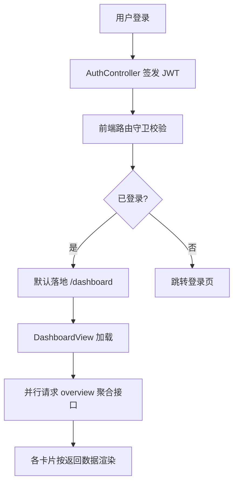
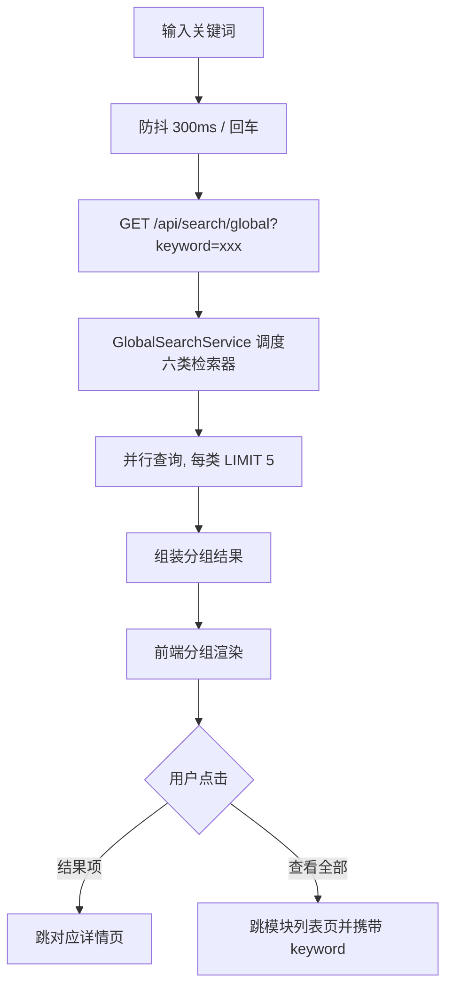

---
AIGC:
    Label: "1"
    ContentProducer: 001191440300708461136T1XGW3
    ProduceID: d9cc1e9f35e2e4edfa52a2013dbcd9a5_8e4f6056d69411f1ad9c525400cd780f
    ReservedCode1: XS78aSC7fxYezM2WLtVjQbX27s/feUB+SHakHix16/01Pmmz0Pfqee4sZ8xvQk5kQnzNb4tFBqltpQtPtuIXaUaGr3u98v6nzMS9zhUXB/RisRomCjMy8NFXDceCTt7AcKqzR21hS8zv5JxtkxV57NCKEnUNGlTtUa9YJgaZfwAuMe50U5DGejbf4zQ=
    ContentPropagator: 001191440300708461136T1XGW3
    PropagateID: d9cc1e9f35e2e4edfa52a2013dbcd9a5_8e4f6056d69411f1ad9c525400cd780f
    ReservedCode2: XS78aSC7fxYezM2WLtVjQbX27s/feUB+SHakHix16/01Pmmz0Pfqee4sZ8xvQk5kQnzNb4tFBqltpQtPtuIXaUaGr3u98v6nzMS9zhUXB/RisRomCjMy8NFXDceCTt7AcKqzR21hS8zv5JxtkxV57NCKEnUNGlTtUa9YJgaZfwAuMe50U5DGejbf4zQ=
---

# 个人工作台 详细设计说明书

## 1. 设计概述

本模块为 jshz-PMO 系统新增"个人工作台"，解决入口分散、反复跳转的效率痛点。设计原则：

1. **复用优先**：知识星球收藏、项目进度、审批、消息、公告等数据能力均已存在，一期**不新建数据库表**，全部复用现有表与接口逻辑。
2. **聚合接口**：新增一个工作台聚合接口 + 一个全局搜索聚合接口，前端一次请求即可渲染整个工作台。
3. **权限零新增**：所有数据展示沿用各模块现有可见性规则，不新增权限码、不额外脱敏。

## 2. 模块结构与依赖

### 2.1 前端

| 层 | 说明 |
|----|------|
| 路由 | 新增 `/dashboard`（工作台），登录守卫默认落地页由 `/experts` 改为 `/dashboard`；侧边菜单保留"个人中心" `/profile` |
| 页面 | `views/dashboard/DashboardView.vue`（容器） |
| 组件 | `GlobalSearchBar.vue`（顶部搜索）、`FavoriteCard.vue`（收藏）、`MyProjectCard.vue`（我的项目）、`MyApprovalCard.vue`（我的申请）、`MessageCard.vue`（消息）、`AnnouncementCard.vue`（公告）、`QuickEntryPanel.vue`（快捷入口） |
| API 封装 | `src/api/dashboard.js`（overview）、`src/api/search.js`（global search） |
| 状态 | 复用 Pinia（通知轮询可继续用于未读角标实时性，可选） |

### 2.2 后端

| 层 | 说明 |
|----|------|
| Controller | 新增 `DashboardController`（GET /api/dashboard/overview）、`GlobalSearchController`（GET /api/search/global） |
| Service | 新增 `DashboardService`（聚合各模块数据）、`GlobalSearchService`（六类检索器聚合） |
| 检索器 | 按模块实现可插拔检索器接口 `ModuleSearcher`：`KnowledgeSearcher` / `ExpertSearcher` / `ProjectSearcher` / `CustomerSearcher` / `SupplierSearcher` / `AnnouncementSearcher` |
| Mapper | 复用现有 Mapper（KnowledgeFavoriteMapper、ProjectMapper、ApplicationMapper、NotificationMapper、AnnouncementMapper、ExpertMapper、CustomerMapper、SupplierMapper） |

### 2.3 依赖关系

```
DashboardView.vue
 ├─ GET /api/dashboard/overview ─ DashboardService
 │    ├─ KnowledgeFavoriteService.listRecent (top 8)
 │    ├─ ProjectService.listByUser (ownerId/executorId, 非DELETED) + project_phase_history 最近推进 + 到期预警
 │    ├─ ApplicationService.countPending + latest 3
 │    ├─ NotificationService.unreadCount + latest 3
 │    └─ AnnouncementService.latest 3 (ONLINE + effective + read status)
 ├─ GET /api/search/global?keyword= ─ GlobalSearchService
 │    └─ ModuleSearcher[] 并行执行，每组 LIMIT 5
 └─ 快捷入口：前端静态配置（无接口）
```

## 3. 核心流程

### 3.1 登录进入工作台



### 3.2 全局搜索



## 4. 接口定义

### 4.1 新增：工作台聚合接口

- **请求方式**：GET
- **请求路径**：`/api/dashboard/overview`
- **鉴权**：登录即可（JWT）
- **请求参数**：无
- **响应参数**：

```json
{
  "code": 0,
  "data": {
    "favorites": { "total": 0, "items": [ { "docId": 1, "title": "会议执行手册", "category": "会议执行", "favoriteTime": "2026-11-01 10:00:00" } ] },
    "myProjects": { "total": 0, "items": [ { "projectId": 1, "name": "2026行业峰会", "currentPhase": "执行阶段", "owner": "张三", "status": "RUNNING", "lastPhaseChangeTime": "2026-11-01 09:00:00", "dueDate": "2026-11-10", "warning": "即将到期" } ] },
    "myApprovals": { "pendingCount": 0, "latestItems": [ { "applicationId": 1, "title": "专家入库申请", "submitter": "李四", "submitTime": "2026-11-01 08:00:00" } ] },
    "notifications": { "unreadCount": 0, "latestItems": [ { "notificationId": 1, "title": "会议通知", "time": "2026-11-01 07:00:00" } ] },
    "announcements": { "items": [ { "announcementId": 1, "title": "放假通知", "publishTime": "2026-11-01", "read": false } ] }
  }
}
```

- **实现要点**：
  - `favorites`：复用 `GET /api/knowledge/favorites` 逻辑，LIMIT 8，收藏时间倒序。
  - `myProjects`：复用 `listProjects` 行级过滤逻辑（ownerId = 当前用户 OR executorId = 当前用户，排除 DELETED），取阶段名称（关联 project_phase）、最近推进记录（project_phase_history 倒序取 1 条）、到期预警（dueDate 距今 ≤ 7 天且未完成 → "即将到期"；dueDate 已过且未完成 → "已逾期"）。
  - `myApprovals`：复用待审批统计与最新申请列表逻辑，pendingCount + LIMIT 3。
  - `notifications`：复用未读数统计 + LIMIT 3 未读。
  - `announcements`：复用公告查询（ONLINE + scope=effective），LIMIT 3，关联 announcement_read 判定当前用户已读状态。

### 4.2 新增：全局搜索聚合接口

- **请求方式**：GET
- **请求路径**：`/api/search/global`
- **鉴权**：登录即可（JWT）
- **请求参数**：

| 参数 | 类型 | 必填 | 说明 |
|------|------|------|------|
| keyword | string | 是 | 搜索关键词，去空白，长度 1~100 |
| page | int | 否 | 分页（每类固定 5 条，一期仅支持第一页） |

- **响应参数**：

```json
{
  "code": 0,
  "data": {
    "keyword": "xxx",
    "groups": [
      { "module": "knowledge", "moduleName": "知识星球", "total": 0, "items": [ { "id": 1, "title": "会议执行手册", "extra": "分类/摘要", "url": "/knowledge-planet/doc/1" } ] },
      { "module": "expert", "moduleName": "专家", "total": 0, "items": [ { "id": 1, "title": "张三", "extra": "所属单位", "url": "/experts/1" } ] },
      { "module": "project", "moduleName": "项目", "total": 0, "items": [ { "id": 1, "title": "2026行业峰会", "extra": "当前阶段", "url": "/project/1" } ] },
      { "module": "customer", "moduleName": "客户", "total": 0, "items": [ { "id": 1, "title": "某公司", "extra": "类型", "url": "/customer-info/1" } ] },
      { "module": "supplier", "moduleName": "供应商", "total": 0, "items": [ { "id": 1, "title": "某酒店", "extra": "类型/城市", "url": "/supplier/1" } ] },
      { "module": "announcement", "moduleName": "公告", "total": 0, "items": [ { "id": 1, "title": "放假通知", "extra": "发布时间", "url": "/profile/announcements" } ] }
    ]
  }
}
```

- **各模块检索规则（沿用现有可见性）**：

| 模块 | 检索逻辑 | 可见性约束 |
|------|----------|-----------|
| knowledge | 复用 C1：title/file_name/content 三列 LIKE | 仅 status=1 上架文档 |
| expert | 复用 ExpertService 检索（keyword 多字段 LIKE） | 全员可查，与列表页一致（不额外脱敏） |
| project | 复用 listProjects + keyword LIKE 项目名/编号 | 无 project:view-all 时仅本人负责/执行；排除 DELETED |
| customer | 复用客户搜索（searchTargets 等） | 登录可查，排除已软删 |
| supplier | 复用供应商检索 | 登录可查 |
| announcement | 标题/内容 LIKE | 仅 ONLINE 且 scope=effective |

- **错误码**：
  - `keyword` 为空或超长：400 参数错误。
  - 未登录：401。
  - 内部错误：500。

### 4.3 复用现有接口清单（前端不新增请求）

| 用途 | 现有接口 |
|------|----------|
| 我的收藏完整列表 | GET /api/knowledge/favorites |
| 项目详情 | GET /api/project/{id} |
| 我的申请页 | /api/approval/*（现有前端页面） |
| 消息中心 | /api/notification/*（现有前端页面） |
| 公告页 | /api/announcement/*（现有前端页面） |
| 通讯录 | /api/wecom/directory/mine（现有前端页面） |

## 5. 数据模型

### 5.1 数据库表设计

**一期不新增任何数据库表**，全部复用：

| 复用表 | 用途 |
|--------|------|
| knowledge_favorite | 收藏卡片数据源 |
| knowledge_document | 收藏标题/分类/正文检索（status=1） |
| project / project_executor | 我的项目（负责人/执行人 + 行级过滤） |
| project_phase / project_phase_history | 当前阶段 + 最近推进记录 |
| application / approval_record | 待审批角标与最新待办 |
| notification | 未读消息 |
| announcement / announcement_read | 公告 + 已读状态 |
| expert_info / customer / supplier | 全局搜索对象 |

### 5.2 缓存设计（可选）

- 全局搜索：一期不加缓存（内网数据量可控）；若响应超阈值，可对高频关键词加 Redis 短 TTL（60s）。
- 工作台聚合：通知角标可复用现有通知轮询机制；其余卡片实时查询。

## 6. 异常处理

| 异常场景 | 处理策略 |
|----------|----------|
| 聚合接口任一模块查询失败 | 该卡片返回空 + 前端占位，整体接口不失败（模块级 try-catch） |
| 全局搜索接口超时 | 前端提示"搜索超时，请重试"；后端六类并行查询设总超时（如 800ms） |
| 项目行级过滤异常 | 默认返回空列表，不泄露他人项目 |
| 无权限访问详情 | 沿用现有 403 处理 |

## 7. 权限与安全

1. **不新增权限码**：工作台与全局搜索登录即可访问。
2. **数据可见性**：全部沿用各模块现有规则（重点核对项目行级过滤、知识文档 status=1、公告 ONLINE+effective、专家检索脱敏现状）。
3. **专家敏感字段**：全局搜索预览字段仅展示标题级信息（姓名/单位），不展示身份证、银行卡等；点进详情与现有专家详情页行为完全一致，不新增脱敏逻辑。
4. **搜索词安全**：keyword 参数做长度与转义校验（LIKE 通配符转义），防注入。

## 8. 前端页面设计

### 8.1 布局草图

```
┌──────────────────────────────────────────────┐
│  顶部导航（Logo + 菜单）         [全局搜索框]   │
├──────────────────────────────────────────────┤
│  ┌───────────────┐  ┌──────────────────────┐ │
│  │ 我的收藏(8)    │  │ 我的项目(条件显示)    │ │
│  │ ...           │  │ 项目卡片(增强)        │ │
│  │ [查看全部]     │  │ [查看全部]           │ │
│  └───────────────┘  └──────────────────────┘ │
│  ┌───────────────┐  ┌───────────────┐       │
│  │ 我的申请(角标) │  │ 最新公告(3)    │       │
│  │ 最新3条        │  │ 已读/未读标记  │       │
│  └───────────────┘  └───────────────┘       │
│  ┌──────────────────────────────────────┐   │
│  │ 未读消息(角标) + 最新3条              │   │
│  └──────────────────────────────────────┘   │
│  ┌──────────────────────────────────────┐   │
│  │ 快捷入口：知识星球 项目管理 专家库     │   │
│  │          客户信息 供应商 我的申请     │   │
│  │          公告 通讯录                 │   │
│  └──────────────────────────────────────┘   │
└──────────────────────────────────────────────┘
```

### 8.2 关键交互

- 全局搜索：输入防抖 300ms，Enter 或点击搜索触发；结果下拉面板分组展示；ESC 或点击外部关闭。
- 预警标记：即将到期（7 天内）橙色标签、已逾期红色标签、正常无标签。
- 快捷入口：Element Plus 图标 + 名称平铺，点击 `router.push` 对应路由。

### 8.3 路由与菜单变更

- `router/index.js`：新增 `/dashboard` 路由；登录守卫默认落地由 `/experts` 改为 `/dashboard`。
- 侧边菜单：新增"工作台"（置顶）；保留"个人中心"。

## 9. 二期展望（本期不做）

- 自定义布局拖拽（卡片增删/排序/隐藏）
- ES 全文索引（当前为后端聚合 LIKE）
- 搜索历史 / 热搜榜
- 最近浏览记录
- 快捷入口自定义配置
- 工作台主题 / 换肤

## 10. 验收标准

| 编号 | 验收项 | 预期 |
|------|--------|------|
| A1 | 登录后默认落地 | 登录成功跳转 /dashboard，非 /experts |
| A2 | 收藏卡片 | 显示最近 8 条收藏，倒序；空态文案正确 |
| A3 | 我的项目卡片 | 负责人/执行人身份自动显示；无项目用户不显示该区；卡片含阶段、最近推进、到期预警 |
| A4 | 待审批 | 角标数量正确；最新 3 条可点击进入我的申请 |
| A5 | 未读消息 | 未读数角标正确；最新 3 条可点击进入消息中心 |
| A6 | 公告 | 仅展示 ONLINE + 生效中；已读/未读标记正确 |
| A7 | 全局搜索六类 | 各模块结果分组展示、每类 ≤ 5 条；可见性正确（项目仅本人可见、知识仅上架、公告仅生效） |
| A8 | 快捷入口 | 8 个入口点击直达对应路由 |
| A9 | 性能 | 聚合接口 P95 ≤ 500ms；全局搜索 P95 ≤ 1s（内网） |
| A10 | 兼容 | Chrome/Edge 最新版正常渲染 |

## 11. 发给开发 Agent 的话

1. 后端新增两个接口：`GET /api/dashboard/overview`、`GET /api/search/global`，实现参考 §4.1 / §4.2。
2. 全局搜索按模块实现可插拔 `ModuleSearcher`，注册顺序固定（knowledge → expert → project → customer → supplier → announcement）。
3. 项目可见性必须复用 `listProjects` 现有行级过滤逻辑，严禁在全局搜索中绕过（重点安全项）。
4. 前端新增 `/dashboard` 路由与组件，登录守卫默认落地页改为 `/dashboard`。
5. 遵守 AGENTS.md 文档同步铁律：代码/接口变更完成后，同步更新本设计文档、architecture.md 与交接文档。
6. 一期不新增数据库表；不新增权限码；不做埋点（如需埋点另行排期）。
*（内容由AI生成，仅供参考）*
