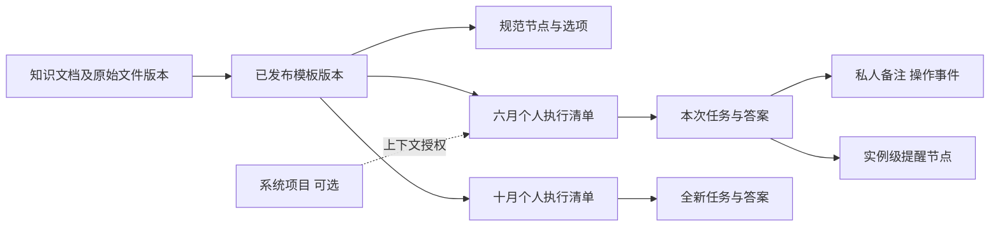

# 企业合规可复用清单技术设计

> **状态提示（2026-11-16）**：文中 `MyTodoSection.vue` 已因零引用在冗余清理中删除；`ExecutionBoard.vue`（我的执行）亦已删除，本文仅作历史设计记录。

- 编号：DES-COMPLIANCE-V4；版本：v4.0评审稿；日期：2026-11-03。
- 对应：[需求文档](../requirements/2026-11-03-企业合规可复用规范与个人执行清单-需求文档.md)。状态：目标技术规格；首期已生产上线、技术只读验证通过，业务体验待复核。实际八表、个人模式/历史快照、接口/权限及限制见 [部署说明](../deployment/2026-11-03-企业合规V4隔离验收灰度切换与回滚-部署说明.md)、[最新交接](../handover/tasks/20261103_compliance_v4_release_blockers.md) 及 [生产记录](../releases/20261103-compliance-v4-production.md)。下文初始七表建议及“本轮”指设计阶段，不作为全部目标已实现或业务已验收的结论。
- 核实基线：267caa1，工作区开始时干净；沿用Java17/Spring Boot/MyBatis-Plus/MySQL、Vue3/Pinia/Element Plus，不迁移技术栈。
- 本轮只读审查代码和已有文档，未连接数据库、未取真实业务附件、未验证生产元数据；不得据本稿直接执行DDL或部署。

## 1. 现状调用链与根因

| 层 | 当前位置 | 已核实行为 |
| --- | --- | --- |
| 页面 | frontend/src/views/EnterpriseCompliance.vue | 顶部待办+维护人看板+文档列表；备注/阻塞/提醒三个独立弹窗 |
| 待办表格 | frontend/src/components/compliance/MyTodoSection.vue | 全部rows直接渲染，只有备注按钮无摘要，阻塞单独主操作 |
| 维护 | frontend/src/components/compliance/MaintenanceBoard.vue:115起 | 同一表单编辑规范内容和dueDate/priority/status/assigneeIds |
| 收藏 | frontend/src/components/KnowledgeDocList.vue:290起 | toggleFavorite修改本地行，不向企业合规页发送刷新事件 |
| API | frontend/src/api/compliance.js；backend/.../controller/ComplianceItemController.java | /items、/my-todo、/my-progress/{itemId}、/my-reminder/{itemId}；公共写入需要knowledge:maintain |
| 待办服务 | backend/.../service/ComplianceService.java:361–439 | 收藏文档事项∪责任人事项；个人完成行仍rows.add；从公共事项读取日期和优先级；逐项查个人记录 |
| 个人数据 | 同Service:453、492；entity/ComplianceUserProgress.java | 个人记录定位仅userId+itemId，没有执行批次；备注只有500字、等待原因与进度混用 |
| 版本 | 同Service:206起，:235删除旧同名事项 | 解析草稿即可能释放旧item_code并迁移个人记录，缺少运行快照边界 |
| 提醒 | backend/.../scheduler/ComplianceDueScheduler.java | 已修复精确日期/资格/幂等/有界重试，但仍按公共事项和收藏/责任人计算，不能支持重复执行 |
| 表设计依据 | database/migration/20261103_add_compliance_tables.sql | 旧compliance_item含公共运行字段；旧user_progress唯一user+item；旧reminder唯一user+item+type+scheduled |

根因是对象维度缺失。修补页面排序、增加个人日期只能缓解表象，不能让同人同文档同一年不同项目独立运行。

## 2. 拟议领域模型

- 模板版本发布后不可原地改写；修改复制为新草稿，发布时对原文件版本与节点引用做校验。
- 执行任务固定模板版本，复制规范必要字段与输入定义；快照提供历史稳定性，不产生新的文件访问权限。
- 运行对象以清单所有人为隔离边界。首期一个任务只有清单所有人，不增加多责任人共同改同一状态的复杂度。
- 项目是可空关联：有项目时复用现有项目行级可读校验，创建及修改关联都校验；无项目则验证个人owner。项目软删/撤权后保留历史标识但禁读项目详情；相关执行提醒暂停并提示处理，转个人用途须另行确认来源权限，不自动脱钩恢复数据访问。

## 3. 拟议数据结构（供开发评审，不是迁移脚本）

推荐新增7张隔离表，保留原5张合规表作为旧模式数据源和历史，不先重命名或破坏旧列。

| 表（拟议） | 核心字段 | 唯一约束/索引 |
| --- | --- | --- |
| compliance_template_version | id BIGINT；document_id/source_document_version_id BIGINT；revision INT；state VARCHAR(16)：DRAFT/PUBLISHED/RETIRED；owner_user_id、published_by；title、applicability TEXT；row_version INT；published_at/create/update DATETIME | unique(document_id,revision)；(document_id,state,revision)；owner/state |
| compliance_template_node | id/version_id/parent_id BIGINT；node_code VARCHAR(64)；title VARCHAR(200)；stage VARCHAR(32)；input_type VARCHAR(24)；instruction/materials/acceptance/time_rule TEXT；required TINYINT；source_anchor JSON；condition_option_id BIGINT NULL；sort INT | unique(version_id,node_code)；(version_id,parent_id,sort) |
| compliance_template_option | id/node_id BIGINT；option_code VARCHAR(64)；label VARCHAR(200)；guidance TEXT；sort INT | unique(node_id,option_code)；(node_id,sort) |
| compliance_execution | id BIGINT；owner_user_id/project_id/template_version_id/source_document_id BIGINT；name VARCHAR(200)；state DRAFT/ACTIVE/COMPLETED/PAUSED/ARCHIVED；start_at/closed_at DATETIME；source_kind TEMPLATE/LEGACY；source_key VARCHAR(128) NULL；idempotency_key VARCHAR(64)；row_version INT；created_at/updated_at | unique(owner_user_id,idempotency_key)；unique(owner_user_id,source_kind,source_key)用于历史导入；(owner_user_id,state,updated_at)；project_id |
| compliance_execution_task | id/execution_id BIGINT；source_node_code VARCHAR(64)；snapshot JSON；answer JSON；applicability APPLICABLE/NOT_APPLICABLE；due_date DATE NULL；priority HIGH/MEDIUM/LOW；progress UNPROCESSED/PROCESSING/COMPLETED；note TEXT NULL；waiting_reason/next_action VARCHAR(500) NULL；review_date DATE NULL；remind_enabled TINYINT；remind_days INT；schedule_revision INT；completed_at DATETIME NULL；row_version INT | unique(execution_id,source_node_code)；(execution_id,progress)；(progress,due_date)；(review_date,progress) |
| compliance_execution_event | id/execution_id/task_id/actor_user_id BIGINT；event_type VARCHAR(40)；payload JSON（字段差异/私人备注历史）；created_at DATETIME | (execution_id,id)；(task_id,id)；不将私人payload写应用日志 |
| compliance_execution_reminder | id/execution_id/task_id/recipient_user_id BIGINT；kind VARCHAR(24)；scheduled_at DATETIME；schedule_revision INT；state PENDING/SENDING/SENT/FAILED/CANCELLED；attempt_count INT；notification_id BIGINT NULL；created_at/updated_at | unique(task_id,recipient_user_id,kind,scheduled_at,schedule_revision)；(state,scheduled_at) |

设计约束：
1. template_node与option只有草稿可改；node_code在新模板版本中可沿用，但匹配以稳定code和人工确认差异为准，禁止凭同名删除旧版本。
2. parent_id必须指向同版本节点，无环且最多两级展示（分组+细项）；condition_option_id只能引用同版本、前置单/多选节点，服务端验证依赖无环。
3. 任务身份不能用document_id/item_code单独定位；相同模板可创建多个execution，每个任务有独立主键。
4. answer JSON按snapshot.input_type/选项code白名单验证；必填缺失不能完成。非适用分支保留已填答案作为历史，不默认复制到新清单；无权限时整个payload不可返回。
5. 备注首期建议2000字符，前后端一致；超限拒绝，禁止静默截断。模板富文本限制长度/附件引用，使用既有清洗能力，禁止脚本和外部自动加载。
6. 因MySQL唯一索引允许多个NULL，LEGACY的source_key导入时强制非空；普通模板执行source_key留空，允许合理多次使用。
7. completed_at与progress在同事务更新；任务重开时当前completed_at清空、事件保留原完成时间。execution总体完成从适用必做任务推导并由服务端校验。
8. due_date与review_date分别是执行到期与等待复查，不混用；未排期不产生到期提醒。时间点采用Asia/Shanghai，接口日期ISO-8601。
9. 模板与任务均带row_version，更新以WHERE id=? AND row_version=?条件写入，冲突返回409供用户刷新比较。

详细DDL、外键/删除策略和索引执行计划须在开发时结合目标MySQL实际元数据补齐；本轮不提供可直接执行的迁移，以免设计稿误用于生产。

## 4. API契约草案与服务边界

沿用ApiResponse格式。建议新入口 /api/compliance/v4，与旧接口并存；这只是规划，不是已存在API。

| 方法与路径（拟议） | 目的/重要契约 |
| --- | --- |
| GET /documents/{documentId}/templates | 读取有权文档已发布模板版本，过滤草稿 |
| POST /documents/{documentId}/templates/drafts | 上传者创建自己的草稿；从指定已发布版本复制，不修改旧版本 |
| GET/PATCH /templates/{templateVersionId} | 拿完整草稿树/携带rowVersion编辑；只白名单模板字段，不接受个人运行字段 |
| POST /templates/{templateVersionId}/publish | 维护权限+源文档权限+版本校验；原子发布，不能分半套节点对员工可见 |
| POST /executions | {templateVersionId,projectId?,name,selectedNodeCodes,idempotencyKey}；owner取登录用户，响应新草稿/已存在同幂等请求 |
| POST /executions/{id}/start | 校验来源/项目/适用项与日期设置，草稿转ACTIVE；此时才进入待办并建立提醒 |
| GET /executions | 本人清单分页，state/projectId/documentId/search；不接受任意ownerId提权 |
| GET /executions/{id} | 本人清单与版本/来源可用性；无权者403或统一404，不暴露存在性敏感信息 |
| POST /executions/{id}/reuse | 新清单；不复制状态/日期/备注/提醒日志；copyAnswers明确选择，仍校验新选项定义 |
| PATCH /tasks/{taskId} | {rowVersion,answer?,dueDate?,priority?,progress?,note?,waiting?}；missing表示不改，null明确清空允许字段 |
| GET /my-tasks | statusScope=ACTIVE/COMPLETED，分页筛选、明确统计作用域；默认服务端不返回完成任务 |
| POST /executions/{id}/pause 或 /archive | 显式暂停/归档并取消未发送提醒；写事件 |
| GET /tasks/{taskId}/events | 本人私人记录，按游标分页，不允许维护人拿ID直接读取 |

上表路径均接在 /api/compliance/v4 后。发布/停用/恢复、继续执行等补充动作应在正式OpenAPI清单中一并定义，不能只实现前端按钮。

拟议服务：TemplateService处理草稿/发布/原文定位；ExecutionService处理创建/复用/状态/所有权；ExecutionQueryService处理联表分页和统计；ExecutionReminderService处理调度节点和通知。避免把v4全部塞入现有ComplianceService。
业务写操作和审计事件同事务；多任务批改采用清单版本或逐任务版本校验，返回明确部分失败结果，不能部分成功却弹“全部保存成功”。

## 5. 权限与隐私边界（高风险待批准）

| 对象 | 普通员工 | 上传者 | 规范维护人 |
| --- | --- | --- | --- |
| 有权文档及发布模板 | 可读/用于本人清单 | 同普通员工 | 在既有授权范围内维护 |
| 草稿 | 默认不可读他人草稿 | 仅自己的草稿可编写 | 按审核授权可发布，不默认获得无权源文档 |
| 执行任务/日期/答案/备注 | 仅本人 | 不因上传而看到员工执行 | 不因knowledge:maintain自动取得私人内容 |
| 项目入口 | 需项目可读权限 | 同左 | 维护权限不能绕过项目可读权限 |
| 通知跳转/导出/快照/附件 | 与任务/源权限一致 | 同左 | 同左 |

- 每个taskId先联execution.owner_user_id校验，再检来源权限与项目关联状态；禁止信任请求body中的ownerId/projectId/snapshot。
- 与旧ADR-020“维护人只读责任人进度”的收敛存在冲突，需负责人确认后修改权限矩阵与迁移权限。未批准前不实施。
- 私人备注/答案不得进入公共模板历史、搜索索引、全局看板或普通操作日志；审计可记对象ID和动作类型，返回私人事件时重新授权。
- 文档撤权应对快照、已知下载URL、缓存和消息正文全部生效；消息正文最小化，不包含备注和敏感条款，只提供授权后可打开的任务链接。
- 原文普通停用与安全撤权需业务层给出不同原因码，不能只靠前端标签判断。历史页也要校验权限。
- 上传者自有草稿权限是新能力，必须后端实现并覆盖越权测试，不沿用“仅隐藏维护按钮”作为授权。

## 6. 运行状态与提醒一致性

执行清单：DRAFT → ACTIVE → COMPLETED；ACTIVE可显式PAUSED/ARCHIVED；恢复需重新校验来源、项目与提醒日期。任务：UNPROCESSED ↔ PROCESSING → COMPLETED，已完成可重开；NOT_APPLICABLE是适用性，不伪装完成。
等待跟进是PROCESSING辅助字段；清除等待/完成/不适用取消review节点。UI不再保留“全局状态”与“个人进度”两套员工操作。

提醒规则：
1. 由任务due_date生成提前/当天节点，由review_date生成独立跟进节点；只扫描ACTIVE清单、适用未完成任务，校验当前来源权限。
2. 改期/关闭/完成/归档在同一事务使旧PENDING失效并递增schedule_revision；发送时再次校验revision、当前日期和权限，禁止仅相信历史排队结果。
3. 到期提醒与跟进同日可合并为一条消息，规则与合并键写入测试；不同execution即使node_code相同也不跨次去重。
4. 单节点独立事务、唯一键与条件领取；NotificationService站内消息与SENT同库原子提交，失败有界重试。保留现有修复经验，不把全部扫描放同一大事务。
5. 并发完成与发送应锁定同一任务行：发送提交前确认未完成；已完成提交之后不能再产生新提醒。发送已先提交的消息可保留历史，但跳转显示已完成状态。
6. 本期不发外部消息、不调用外部模型。若以后外部通知，另需outbox/外部幂等键，不能把数据库事务假定可回滚外部发送。

## 7. 前端实现与查询

- EnterpriseCompliance保留现有路由，内部页签化；新增TemplateEditor、ExecutionCreateWizard、ExecutionTaskList、ExecutionTaskDrawer、CompletedHistory；组件按模块目录组织。
- KnowledgeDocList为跨模块公用组件，新增可选插槽/回调提供“用于本次项目”和收藏变更事件，不把所有知识分类强行变为合规任务；旧分类默认行为不变。
- 新Pinia store按executionId保存局部数据，统一完成/备注/排期/收藏事件刷新和错误处理，避免多组件各自fetch维护互相矛盾的计数。
- 主列表后端分页，先按owner与execution state过滤，再联任务/来源/项目授权；完成过滤应在SQL分页之前，不允许只在当前页前端过滤造成空页或错误总数。
- 批量预取源文档、项目名称及模板版本，不沿用myTodo逐项select个人记录的N+1；按真实量级做EXPLAIN与性能回归。
- 备注区提供摘要、完整文本和明确保存按钮；成功才移除完成行，短时撤销调用后端重开，409展示冲突而不是静默覆盖。
- 窄屏转任务卡片，备注与上下文不挤进多个固定宽列；键盘可操作，不依赖hover识别内容；空态明确“收藏入口”和“开始执行”的区别。

## 8. 历史迁移与灰度（必须另行批准）

### 8.1 不能直接做的转换
- 不把旧公共due_date/priority/status覆盖所有员工的新设置；不将同名事项认定为跨版本同一业务动作；不推断六月项目或十月项目归属。
- 不DELETE旧表或清空个人备注/提醒日志；不在生产按本设计文档直接跑批。

### 8.2 建议顺序
1. 先读实际元数据、旧事项/个人记录/责任关系数量、孤儿记录数量、历史完成分布；形成只读对账SQL与预计影响行数。仅取必要字段，不导出全量正文或个人备注到外部。
2. 新表迁移脚本必须声明真实目标MySQL版本，支持重复执行检测、备份与回滚，测试库演练；本稿不代替脚本。
3. 先把现有公共内容生成“待审核模板草稿”，公共日期和状态作为旧来源说明保留，不当成新模板运行字段。人工补协会选项等结构化定义，确认后发布。
4. 有旧个人进度或明确责任关系的用户：生成个人“历史执行·待核对”容器，保留原日期/优先级/状态/备注的来源说明；已完成归历史；未完成可由用户确认迁为ACTIVE并重新排期。若所有人直接默认激活会造成双发，禁止自动批量开始。
5. 只有收藏、没有个人记录的用户：保留收藏，提示“创建执行清单”，不生成一堆未开始任务。找不到原事项的孤儿记录进入受限迁移异常清单，不伪造新任务。
6. 每条legacy映射存稳定source_key和批次ID，重复跑只补缺不重置用户修改；迁移前后按用户/状态/备注非空数/映射数对账，异常人工处理。
7. 以用户或明确迁移映射为互斥切换单元：v3与v4不可对同一执行同时写入/发提醒。新配置开关、灰度映射及旧调度排除规则仅为拟议，正式开发必须记录到部署文档。
8. 灰度确认后扩大范围，旧API保留只读兼容窗口；旧客户端写入已切换对象返回明确冲突/升级提示，不能返回成功却写到无效旧表。

### 8.3 回滚
- 新旧模式数据均保留，切换标记可回退；v4已新增的清单不能凭空塞回v3 user+item结构。回滚时保留v4历史只读入口或兼容服务，再停新调度，避免“应用回退成功但个人任务丢失”。
- 发生提醒异常先关闭新任务生成/发送，再对账已发通知，不删除日志重发。发布仍使用已验证的后端蓝绿与前端不可变root方案，需独立发布审批。

## 9. 需求映射与验证计划

| 需求 | 技术验证 |
| --- | --- |
| FR01/AC01 模板细项 | 结构树、选项code唯一、依赖无环、草稿权限、富文本清洗、解析失败、发布原子性 |
| FR02/03/AC02/03/09 | 同人同文档两次、不同人同项目、同幂等键并发、旧答案失效、新版本固定、复制不带完成/日期 |
| FR04/05/AC04 | dueDate空值语义、字段白名单、完成必填校验、服务端过滤+统计、撤销失败与409、同时间稳定排序 |
| FR06/07/AC05/06 | 备注摘要/长度/保存失败、备注事件越权、等待解除/完成取消复查、窄屏与键盘 |
| FR08/AC07/11 | 收藏事件同步、创建清单刷新、项目撤权、普通维护人尝试读他人任务/备注/导出拒绝 |
| FR09/AC08/10 | 固定时钟、跨次幂等、改期revision、关闭/完成并发、撤权/停用差异、重复调度、失败恢复、单节点事务 |
| AC12 迁移 | 空库/有历史/孤儿/重复运行/部分失败/回滚；行数及映射对账，v3/v4不双发 |

验收层次：纯领域测试 → 隔离真实MySQL事务/唯一键/权限集成 → 浏览器连接隔离后端E2E（不能只用mock API替代）→ 灰度用户复核 → 批准后生产发布与只读验证。
本轮只完成设计核查与文档一致性检查，没有新增代码、执行测试或验证任何拟议能力。

## 10. 实施拆分与评审门槛

- T1 明确D02–D08与权限/迁移原则，固定模板字段、状态、数据字典和API草案；业务负责人批准。
- T2 新表与迁移/对账工具、资源授权和只读历史入口；用真实隔离MySQL验证。
- T3 模板编辑/预览/发布（含协会选择细项），不切换旧员工待办。
- T4 个人执行创建/项目关联/复用、实例级提醒、完成与备注界面，全链路隔离测试。
- T5 灰度迁移、业务验收、兼容窗口与回滚演练，另立生产发布审批。
- 任何阶段不得把本设计待评审事项写成已实现；不因本轮文档任务直接修改登录、权限、数据库或运行配置。
